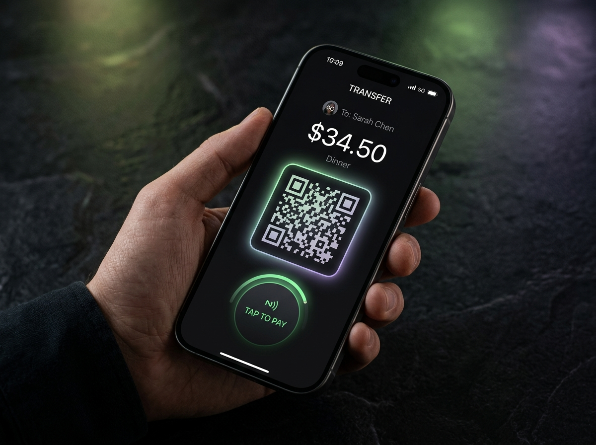

<div align="center">

# 🧉 MatePay

Pagá y cobrá en dólares digitales (USDC) sobre Solana, con QR y alias. Sin tener SOL para las comisiones.



</div>

Prototipo hecho en la **Hackathon Colosseum Crypto World's Fair x Superteam Argentina**.

> ⚠️ **Solo Solana Devnet.** La plata es de prueba (sale de faucets). El server se niega a arrancar si el RPC no es devnet.

## Qué hace

- **Cobrar (POS):** el comercio ingresa el monto en pesos, se convierte a USDC con la cotización en vivo (DolarAPI) y se genera un QR de Solana Pay. El POS confirma el pago solo cuando lo ve en la cadena con el monto, el token y el destino correctos.
- **Pagar:** el cliente escribe un `@alias`, pega una dirección o escanea el QR con la cámara. Ve el monto en USD y ARS y confirma con su wallet.
- **Sin SOL (gasless):** MatePay arma la transacción y figura como **fee payer**. La wallet del cliente solo firma la transferencia de USDC.
- **Mi cuenta:** saldo real, historial de movimientos con link al explorer y registro de `@alias` **firmado con la wallet**, así nadie puede registrar un alias a nombre de otra dirección.
- **Demo en vivo:** POS y cliente lado a lado, con transacciones reales en devnet.

## Cómo funciona un pago

1. El POS crea un cobro en el server, que le asigna una `reference` única, y muestra el QR.
2. El cliente escanea el QR o escribe el `@alias`. El server arma la transacción con MatePay como fee payer y la firma.
3. La wallet del cliente firma solo la transferencia de USDC. El server la envía a devnet y espera la confirmación.
4. El POS consulta cada 2 s. El server busca la `reference` en la cadena, valida monto, token y destino, y marca el cobro como pagado.

Con la app publicada en HTTPS (`APP_URL`), el QR es un **transaction request** de Solana Pay: Phantom mobile lo escanea y paga sin SOL. Sin HTTPS, el QR es un **transfer request** clásico: MatePay (pestaña Pagar → cámara) sigue pagando sin gas, pero otras wallets cobran su comisión.

## Stack

React 19, TypeScript, Vite, Tailwind CSS, Motion, Express, `@solana/web3.js`, `@solana/spl-token`, Solana Wallet Adapter, `html5-qrcode`.

## Cómo correrlo

**Requisitos:** Node.js 20+ y [Phantom](https://phantom.app) en modo devnet (Settings → Developer settings → Testnet mode).

1. Instalá y levantá la app:
   ```bash
   npm install
   cp .env.example .env   # opcional: todo tiene valores por defecto para devnet
   npm run dev
   ```
2. Abrí `http://localhost:3000`.
3. La primera vez el server crea dos wallets de devnet en `.keys/` (ignorada por git) y muestra sus direcciones en la consola:
   - **fee-payer:** paga las comisiones de todos. **Necesita SOL de devnet**: pegá su dirección en [faucet.solana.com](https://faucet.solana.com). Sin SOL, los pagos fallan.
   - **demo-merchant:** el comercio `@cafedelaesquina` de la Demo en vivo. Solo recibe.
4. Para pagar, cargá **USDC de prueba** en tu wallet desde [faucet.circle.com](https://faucet.circle.com) (red Solana Devnet). **Tu wallet no necesita SOL.**

### Probar con el celular (QR real)

Phantom mobile necesita una URL pública HTTPS:

```bash
npx cloudflared tunnel --url http://localhost:3000   # o: ngrok http 3000
```

Poné la URL `https://...` en `APP_URL` del `.env` y reiniciá el server.

### Smoke test

Con el server corriendo:

```bash
npx tsx scripts/smoke-test.ts http://localhost:3000
```

### Build de producción

```bash
npm run build && npm start
```

## Variables de entorno

Todas son opcionales. Ver [.env.example](.env.example).

| Variable | Para qué |
|---|---|
| `SOLANA_RPC_URL` | RPC de devnet. Vacío = público (`api.devnet.solana.com`). Conviene Helius/Triton devnet. |
| `FEE_PAYER_SECRET_KEY` | Wallet que paga las comisiones. Vacío = se genera en `.keys/`. |
| `DEMO_MERCHANT_SECRET_KEY` | Wallet del comercio demo. Vacío = se genera en `.keys/`. |
| `APP_URL` | URL pública HTTPS. Activa los QR de tipo transaction request. |
| `MAX_PAYMENT_USDC` | Tope por pago (default `1000`). |
| `PORT` | Puerto del server (default `3000`). |
| `VITE_SOLANA_RPC_URL` | RPC para el wallet adapter del front. |
| `VITE_SHOW_STUDIO` | `true` muestra las herramientas internas del equipo (mentor, analizador, skills). |
| `GEMINI_API_KEY` | Solo para las herramientas internas. No hace falta para pagar. |

## API

| Endpoint | Qué hace |
|---|---|
| `GET /api/matepay/config` | Red, mint USDC, fee-payer y su saldo |
| `GET /api/matepay/balance/:address` | Saldo SOL y USDC |
| `GET /api/matepay/history/:address` | Últimos movimientos en USDC |
| `GET /api/matepay/alias/:alias` · `GET /api/matepay/alias-of/:address` | Resolver alias |
| `POST /api/matepay/alias` | Registrar alias (requiere firma de la wallet) |
| `POST /api/matepay/payment-requests` · `GET /api/matepay/payment-requests/:id` | Crear cobro / consultar si se pagó |
| `POST /api/matepay/tx/build` | Armar transferencia gasless firmada por el fee-payer |
| `POST /api/matepay/tx/submit` | Enviar la transacción firmada por el cliente |
| `GET/POST /api/solana-pay/:id` | Solana Pay transaction request (lo que lee Phantom) |

## Seguridad

- El server verifica el genesis hash del RPC y no arranca si no es devnet.
- El fee-payer nunca puede figurar como pagador ni como destinatario de un cobro.
- Si se paga un cobro del POS, el monto y el destino salen del cobro guardado, no de lo que mande el cliente.
- Tope por pago (`MAX_PAYMENT_USDC`), cobros que vencen a los 15 minutos y límite de requests por IP.
- Las claves de devnet viven en `.keys/` y `.env`, ambos ignorados por git.

## Estructura

```
server.ts               Express + Vite middleware
server/matepay/         Rutas, lógica de Solana (fee payer, tx gasless) y store JSON
shared/matepay.ts       Tipos y parser de QR/alias compartidos entre server y front
src/components/         PosTerminal, ClientPay, Account, LiveDemo, QrScanner, SolanaPayQr
src/solana/             Wallet Adapter (Phantom en devnet)
scripts/smoke-test.ts   Prueba rápida de la API
```

## Limitaciones conocidas

- Alias y cobros se guardan en `data/*.json`. Alcanza para la demo; para producción hace falta una base de datos.
- El RPC público de devnet tiene límites de uso; con varios usuarios conviene uno propio.
- Si el fee-payer se queda sin SOL de devnet, los pagos fallan hasta recargarlo.

## Equipo

- **Mauricio Montero:** backend, Solana Pay y fee payer
- **Juan Pablo Gerez:** frontend, Wallet Adapter y lector de QR
- **Máximo Robles:** UX, conversor ARS/USDC y video demo
